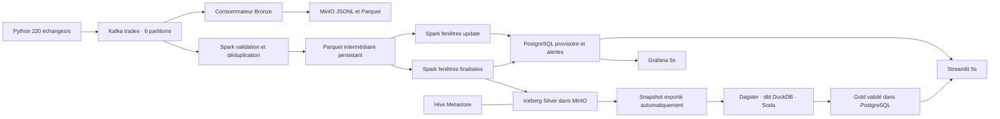

# Plateforme de marché financier simulé

Sujet 4, octobre 2026. Membres du groupe : à renseigner par les auteurs.
20 symboles d'entreprises réelles ; tous les prix et échanges sont simulés.
Aucun indicateur ne prédit les cours. Les symboles réels sont une adaptation
explicitement demandée du sujet, qui emploie des actions fictives.

## Démarrage Windows

Prérequis : Docker Desktop démarré en mode Linux, 16 Go de RAM physique,
au moins 8 Go attribués à Docker, 15 Go de disque disponible. Dans ce dossier :

```powershell
Copy-Item .env.example .env  # seulement si .env n'existe pas encore
docker compose up -d --build
```

Deux commandes suffisent. Les valeurs de `.env.example` sont des identifiants
locaux de démonstration ; les personnaliser dans `.env`, ignoré par Git.
La première construction télécharge des images volumineuses. Moins de cinq
commandes ne signifie pas cinq minutes. Ensuite : `docker compose up -d`.
Les anciens événements Bronze/Kafka avec `volume` sont acceptés : ce champ
historique désigne une quantité. Le générateur utilise maintenant `quantity`.

| Interface | Adresse | Accès |
|---|---|---|
| Streamlit | http://localhost:8501 | Analyses et alertes |
| Grafana | http://localhost:3001/d/finance-live | admin / GRAFANA_PASSWORD |
| Dagster | http://localhost:3000 | Tâches et historique |
| MinIO | http://localhost:9001 | S3_ROOT_USER / S3_ROOT_PASSWORD |

`init` terminé avec code 0 est normal. Spark attend le catalogue. PostgreSQL
reçoit les chandeliers provisoires après les premiers micro-lots. Silver attend
le watermark. Gold attend une exécution Dagster, planifiée toutes les cinq
minutes. MA20 et MA50 nécessitent 20 et 50 minutes observées. Le rendement
quotidien exige une clôture la veille. Aucun faux historique n'est injecté.

## Architecture



Les tâches planifiées ne commandent ni le générateur, ni Kafka, ni Spark.
Voir [architecture](docs/ARCHITECTURE.md), [dictionnaire](docs/DATA_DICTIONARY.md),
[couverture](docs/COVERAGE.md), [validation](VALIDATION.md),
[démonstration de 7 minutes](docs/DEMO.md) et [licences](docs/LICENSES.md).
Le [rapport PDF de 12 pages](output/pdf/rapport_plateforme_financiere.pdf) dispose
de sa [source Markdown](docs/REPORT.md). Les captures réelles sont dans
[docs/evidence](docs/evidence).

## Contrôles

```powershell
docker compose ps -a
docker compose logs --tail 20 producer consumer-bronze spark
docker compose exec kafka /opt/kafka/bin/kafka-topics.sh --bootstrap-server kafka:29092 --describe --topic trades
docker compose exec kafka /opt/kafka/bin/kafka-console-consumer.sh --bootstrap-server kafka:29092 --topic trades --max-messages 5 --property print.key=true --property print.partition=true
docker compose exec postgres psql -U finance -d finance -c "SELECT symbol,count(*),count(*) FILTER (WHERE is_final) finalized FROM candles GROUP BY symbol ORDER BY symbol;"
docker compose exec dagster python gold.py
docker compose run --rm --no-deps -v "${PWD}/scripts:/checks:ro" producer python /checks/verify_runtime.py
```

Le débit obligatoire est celui des confirmations Kafka : `DEBIT confirme=.../s`
doit atteindre 200/s sur plusieurs fenêtres après chauffe. Le script échantillonne
la réception, les clés, les symboles, les partitions et un lot Bronze complet.
Un choc de +8 % sur AAPL intervient après 360 secondes du producteur, puis
chaque 300 secondes. La ligne détectée dans Streamlit constitue la preuve
d'alerte ; le log CHOC prouve seulement l'injection.

## Tests sans infrastructure externe

```powershell
docker compose run --rm --no-deps -v "${PWD}/tests:/tests:ro" producer python -m unittest discover -s /tests -v
docker compose run --rm --no-deps -v "${PWD}/scripts:/checks:ro" dagster python /checks/test_gold.py
docker compose run --rm --no-deps --entrypoint /opt/spark/bin/spark-submit -v "${PWD}/scripts:/checks:ro" spark --master local[2] /checks/test_spark.py
docker compose run --rm --no-deps -v "${PWD}/scripts:/checks:ro" -v "${PWD}/postgres:/schema:ro" producer python /checks/test_serving.py
```

La CI vérifie Python, Compose et Gold sur un jeu temporaire explicitement simulé.
Elle exécute également Spark local et Soda, sans Kafka ni stockage externe.
Elle ne certifie pas le débit ni le rendu visuel des interfaces.

## Reprise

```powershell
docker compose restart consumer-bronze spark
docker compose logs --since 2m consumer-bronze spark
docker compose exec kafka /opt/kafka/bin/kafka-consumer-groups.sh --bootstrap-server kafka:29092 --describe --group bronze-trades-writer
docker compose stop producer
docker compose stop
```

Les checkpoints et les volumes doivent être conservés ensemble. Après reprise,
contrôler les clés et les volumes d'un chandelier déjà finalisé. `down` garde
les volumes ; `down -v` les détruit. Kafka conserve 24 h ou environ 1 Gio par
partition. Spark échoue explicitement si des offsets ont expiré. La reconstruction
depuis Bronze nécessite un traitement séparé, non automatisé dans cette maquette.

Les erreurs dbt/Soda bloquent la publication Gold. Les rejets de contrat sont
identifiables dans `/state/rejected`, avec brut et coordonnées Kafka. Les abandons
au-delà du watermark sont comptés dans `/state/metrics` ; leur brut reste dans
Bronze. Les manifestes Bronze servent au vérificateur et à l'audit des offsets.
La documentation et le lineage dbt sont générés dans `/app/dbt/target` du service
Dagster. Ils peuvent être servis avec `dbt docs serve` dans un environnement de
développement ; l'application de présentation reste Grafana et Streamlit.

## Versions

Kafka 3.8.0 ; Spark 3.5.5, Scala 2.12, Java 11 ; Iceberg 1.7.2 avec AWS bundle
1.7.2 et S3FileIO ; Hive 4.0.0 ; PostgreSQL 16.8 ; MinIO compatible S3
(pgsty/silo figé par digest) ; dbt Core/dbt-duckdb 1.9.2 ; DuckDB 1.0.0 ;
Soda Core 3.5.6 ; Dagster 1.9.13 ; Grafana OSS 11.6.0 ; Streamlit 1.43.2.
Le connecteur Kafka correspond exactement à Spark et Scala. Les dépendances Java
sont résolues à la construction. Aucun téléchargement manuel dans les conteneurs.
Les tags sont explicites, mais les transitives ne sont pas encore verrouillées
par hash. Cette pile mono-broker est une maquette locale.
